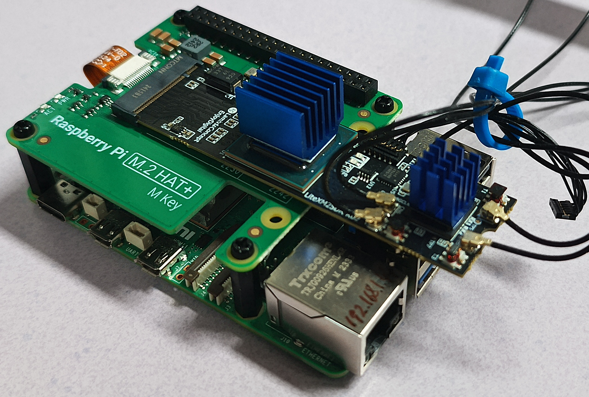
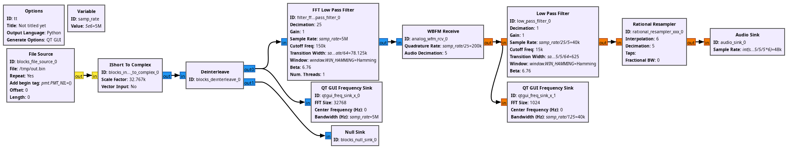
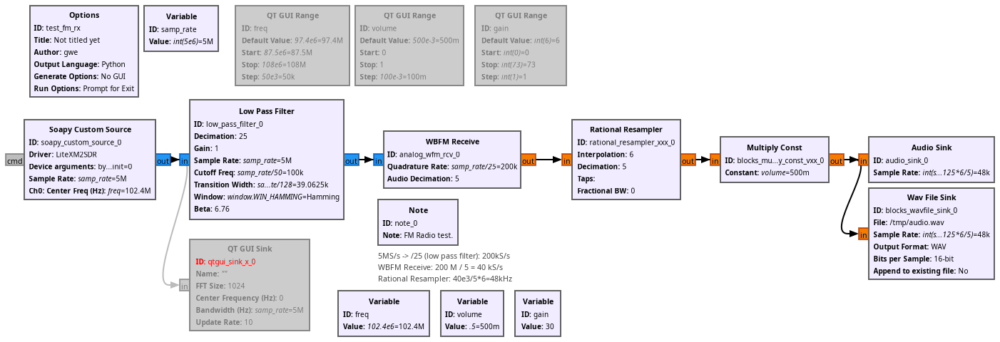
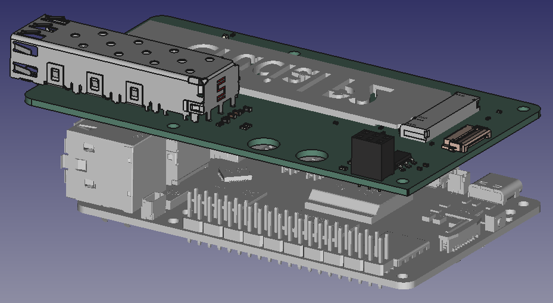
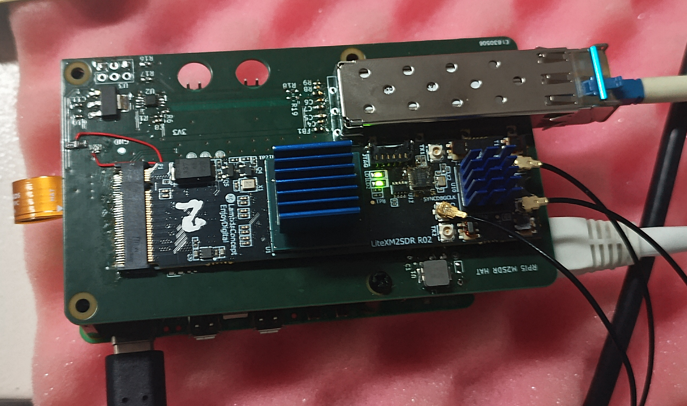

# Running LiteX-M2SDR on the Raspberry Pi 5: commercial HAT

The M2SDR is connected to the Raspberry Pi 5 through the M2 HAT (Hardware Attached 
on Top) found at https://www.kubii.com/fr/raspberry-pi-5/4114-m2-hat-plus-5056561803463.html



Using the PCI board providing JTAG access on the USB-C connector, flash the 
``litex_m2sdr_m2_pcie_operational.zip`` bitstream found
at https://github.com/enjoy-digital/litex_m2sdr/issues/30 using 
```
openFPGALoader -c ft4232 --fpga-part xc7a200tsbg484 --freq 20e6 -f litex_m2sdr_m2_pcie.bin 
```

## Using the binary Raspberry Pi OS

Use ``kernel=kernel8.img`` in accordance with
https://github.com/raspiblitz/raspiblitz/issues/4346 for using 4 KB memory page
size rather than the default kernel using 16 KB memory page size which confuses
DMA allocation.

Append the ``config.txt`` in the first FAT partition with
```
[cm5]
dtoverlay=dwc2,dr_mode=host

kernel=kernel8.img

[all]
dtparam=pciex1=on
dtoverlay=pcie-32bit-dma-pi5
dtoverlay=pciex1-compat-pi5,l1ss=off,no-l0s=on,no-mip=off
```

Append at the end of the ``cmdline.txt`` in the fist FAT partition the Linux 
kernel options
```
pci=noaer pcie_aspm=off iommu.passthrough=1 arm-smmu.disable=1
```

## Testing with M2SDR tools

Follow the testing sequence described at 
https://github.com/enjoy-digital/litex_m2sdr/issues/18 and ending, if all tests
are positive, with

```
./m2sdr_rf --rx_freq 102.4e6 --rx_gain 70 --samplerate 5e6
./m2sdr_record /tmp/out.bin 750000000
```
which is postprocessed with the GNU Radio flowchart



identifying how data are stored as interleaved complex short (16 bit) integers.

## Testing with GNU Radio

The [following flowchart](raspberry-pi-5_FM.grc) is used to demonstrate 
continuous data acquisition at 5 Msamples/s and real time decoding of the 
commercial wideband analog FM signal using the M2SDR Soapy source. 
Tune to your local station frequency.



# Dedicated RPi5 HAT for White Rabbit





Synthesis and compilation:
```
vivado:~/litex_m2sdr$ LITEX_WR_NIC_DIR=/home/jmfriedt/WR/litex_wr_nic/ ./litex_m2sdr.py --variant rpi5hat --with-pcie --with-white-rabbit --build
$ openFPGALoader -c ft4232 --fpga-part xc7a200tsbg484 --freq 20e6 -f ./build/litex_m2sdr_rpi5hat_pcie_x1_white_rabbit/gateware/litex_m2sdr_rpi5hat_pcie_x1_white_rabbit.bit
```

When booting the RPi5, ``lspci`` must show
```
0001:01:00.0 RF controller: Xilinx Corporation Device 7021
```

Getting IQ samples (compilation and acquisition on the RPi5):
```
raspberrypi:~/litex_m2sdr/litex_m2sdr/software $ ./build.py 
raspberrypi:~/litex_m2sdr/litex_m2sdr/software/kernel $ sudo insmod m2sdr.ko 
[ 3120.364243] m2sdr 0001:01:00.0: \x1b[1m[Probing device]\x1b[0m
[ 3120.364263] m2sdr 0001:01:00.0: enabling device (0000 -> 0002)
[ 3120.364362] m2sdr 0001:01:00.0: Version LiteX-M2SDR SoC / m2 variant / built on 2026-05-15 16:58:50
[ 3120.364466] m2sdr 0001:01:00.0: 1 MSI IRQs allocated.
[ 3120.364485] m2sdr 0001:01:00.0: DMA0: 256 x 8192 bytes (2048 KiB ring), MSI every 8 buffer(s)
[ 3120.378413] m2sdr 0001:01:00.0: PTP clock registered as /dev/ptp1
[ 3120.378433] m2sdr 0001:01:00.0: Creating /dev/m2sdr0
raspberrypi:~/litex_m2sdr/litex_m2sdr/software $ cd user/
raspberrypi:~/litex_m2sdr/litex_m2sdr/software/user $ sudo chmod 777 /dev/m2sdr0 
raspberrypi:~/litex_m2sdr/litex_m2sdr/software/user $ ./m2sdr_rf --rx_freq 102.4e6 --rx_gain 70 --samplerate 5e6
raspberrypi:~/litex_m2sdr/litex_m2sdr/software/user $ ./m2sdr_record /tmp/out.bin 750000000
```

## Connecting to the White Rabbit terminal:

On ``screen``1:
```
raspberrypi:~/litex_m2sdr/litex_m2sdr/software/kernel $ bar=`lspci | grep Xil | cut -d\  -f1`
raspberrypi:~/litex_m2sdr/litex_m2sdr/software/kernel $ litex_server --pcie --pcie-bar $bar
[CommPCIe] bar: 0001:01:00.0
tcp port: 1234
```

On ``screen``2:
```
vivado:~/litex_m2sdr$ scp ./scripts/csr.csv 192.168.1.44:/tmp
raspberrypi:~/litex_m2sdr/litex_m2sdr/software/kernel $ litex_term crossover --csr-csv /tmp/csr.csv
[main] calibrating usleep(): loops per jiffy = 6942
[dev] spi_flash: device ID = 0x00000000, size=1 bytes
[storage] mounting 'spi-flash' [1 bytes]
[storage] try entry point 0x00000000
[storage] SDBFS not found.
[dev] wdiags: base addr = 0x100800.
WR Core: starting up...
[dev] Registered network interface 0 @ 00100100
[phy] Running long PHY reset...
[phy] PHY reset complete
[storage] storage_get_persistent_mac: SDB error
[storage] storage_get_persistent_mac: failure
[board] Failed to get MAC address from the flash. Using fallback address.
[storage] storage_load_calibration: can't open cal file
PPSi for WRPC. Commit wrpc-v5.0-ohwr-25-g33d8c46c, built on Nov 25 2026
[phy] Error -1 while reading t24p from storage
executing: vlan off
Unrecognized command "vlan".
executing: ptp stop
executing: sfp match
Wrong SFP checksum 
SFP read error
Command "sfp": error -5
executing: mode slave
executing: ptp start
Empty init script...
wrc# Wrong SFP checksum 
# gui
SAWR WRPC Monitor v8.0-249-g13527cd6-dirty | Esc/q = exit; r = redraw

TAI Time: 1970-01-01-00:05:05  UTC offset: 0    PLL mode: BC  state: Locking
---+-------------------+-------------------------+---------+---------+-----
 # |        MAC        |       IP (source)       |    RX   |    TX   | VLAN
---+-------------------+-------------------------+---------+---------+-----
 0 | 22:33:44:55:66:77 |                         |       0 |     150 |    0

--- HAL ---|------------- PPSI ------------------------------------------------
 Itf | Frq |  Config   | MAC of peer port  |    PTP/EXT/PDETECT States   | Pro 
-----+-----+-----------+-------------------+-----------------------------+-----
 wr0 |     | auto      | 00:00:00:00:00:00 | LISTENING/IDLE      /WA_MSG | R-W 
Pro(tocol): R-RawEth, V-VLAN, U-UDP

--------------------------- Synchronization status ----------------------------
Link down, master mode or sync info not valid
```

## Using the SFP as Network Interface Controller (NIC)

```
raspberrypi:~ $ git clone https://github.com/enjoy-digital/litex_wr_nic
raspberrypi:~ $ cd litex_wr_nic/litex_wr_nic/software/kernel/
raspberrypi:~/litex_wr_nic/litex_wr_nic/software/kernel $ make
raspberrypi:~/litex_wr_nic/litex_wr_nic/software/kernel $ sudo insmod litepcie.ko
[ 1383.258722] litepcie 0001:01:00.0: \x1b[1m[Probing device]\x1b[0m
[ 1383.258738] litepcie 0001:01:00.0: enabling device (0000 -> 0002)
[ 1383.273832] litepcie 0001:01:00.0: Version \x01[
[ 1383.273839] litepcie 0001:01:00.0: PCIe PTM not supported by PCIe bus/controller
[ 1383.273940] litepcie 0001:01:00.0: 1 MSI IRQs allocated.
[ 1383.274223] litepcie 0001:01:00.0 liteeth0: Ethernet MAC0: irq 187, slots: tx 4 rx 4, size 2048
raspberrypi:~/litex_wr_nic/litex_wr_nic/software/kernel $ sudo ifconfig liteeth0
liteeth0: flags=4098<BROADCAST,MULTICAST>  mtu 1500
        ether 10:e2:d5:00:00:00  txqueuelen 1000  (Ethernet)
        RX packets 0  bytes 0 (0.0 B)
        RX errors 0  dropped 0  overruns 0  frame 0
        TX packets 0  bytes 0 (0.0 B)
        TX errors 0  dropped 0 overruns 0  carrier 0  collisions 0
        device interrupt 187  
```
